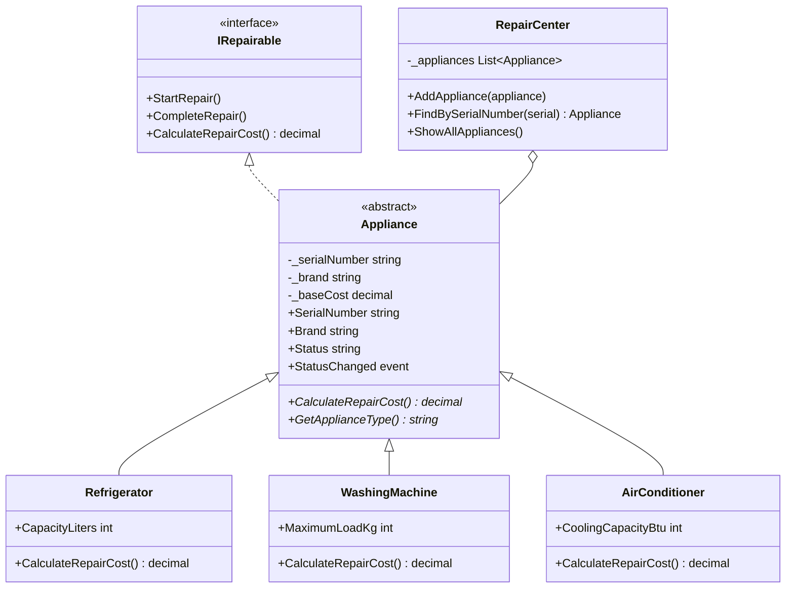

# تقرير الوظيفة التطبيقية: نظام إدارة مركز صيانة وإصلاح الأجهزة المنزلية

## 1. فكرة المشروع
يهدف المشروع إلى تسجيل الأجهزة المنزلية التي تصل إلى مركز الصيانة، ومعرفة نوع الجهاز ورقمه التسلسلي واسم الزبون ووصف العطل وحالة الصيانة وتكلفة الإصلاح. يمكن بدء الصيانة وإنهاؤها والبحث عن جهاز وعرض الأجهزة المتأخرة.

## 2. شرح مبادئ البرمجة كائنية التوجه

### التجريد (Abstraction)
أنشأنا الواجهة `IRepairable` التي تحتوي على `StartRepair` و`CompleteRepair` و`CalculateRepairCost`. وأنشأنا الفئة المجردة `Appliance` التي تجمع البيانات والسلوك المشترك بين الأجهزة، وتحتوي على الدالة المجردة `CalculateRepairCost` التي يجب أن تنفذها الفئات المشتقة.

### الوراثة وتعدد الأشكال (Inheritance & Polymorphism)
الفئات `Refrigerator` و`WashingMachine` و`AirConditioner` ترث من `Appliance`. كل فئة تعيد تعريف `CalculateRepairCost` باستخدام `override` وتضيف قيمة مناسبة لنوع الجهاز. في `RepairCenter` نستخدم `List<Appliance>` لتخزين أنواع مختلفة، ثم نستدعي `CalculateRepairCost` دون الحاجة إلى معرفة نوع كل عنصر؛ وهذه هي فكرة تعدد الأشكال.

### التغليف (Encapsulation)
الحقول مثل `_serialNumber` و`_brand` و`_baseCost` معرفة على أنها `private`. الوصول إلى البيانات يتم عبر الخصائص. الخاصية `SerialNumber` للقراءة فقط، و`Status` لا تتغير إلا من داخل الفئة من خلال `private set`. أما `BaseCost` فتملك `protected set` حتى تستطيع الفئات المشتقة استخدامها دون السماح للكود الخارجي بتغييرها مباشرة.

### التفويض والأحداث (Delegates & Events)
عرّفنا `ApplianceStatusChangedHandler` كتفويض يحدد شكل دالة التنبيه، ثم عرّفنا الحدث `StatusChanged`. عند بدء الصيانة أو اكتمالها يتم إطلاق الحدث، وتستقبل `RepairCenter` التنبيه وتعرضه. كما تفحص `CheckLateAppliances` الأجهزة التي تجاوزت سبعة أيام ولم يكتمل إصلاحها وتعرض تنبيهاً.

### الفئات والأعضاء الثابتة (Static)
تحتوي `ValidationHelper` على دوال ثابتة للتحقق من الرقم التسلسلي والتاريخ والتكلفة. كما تحتوي `Appliance` على الخاصيتين الثابتتين `TotalAppliances` و`TotalRepairCosts` لإظهار عدد الأجهزة ومجموع تكاليف الإصلاح المكتملة.

## 3. مخطط UML مبسّط

## 4. طريقة الاستخدام
عند تشغيل البرنامج تظهر قائمة تتيح عرض الأجهزة، وبدء صيانة جهاز، وإنهاء صيانته، والبحث عنه باستخدام الرقم التسلسلي، وفحص التأخير، وعرض الإحصائيات. توجد ثلاثة أجهزة تجريبية لتسهيل تجربة النظام، ويمكن تعديل بياناتها داخل `Program.cs`.

## 5. ملاحظات
- القيم الإضافية لتكاليف إصلاح الأنواع (150 للثلاجة، و100 للغسالة، و200 للمكيف) افتراضية لأغراض المثال وليست أسعاراً حقيقية.
- البيانات محفوظة في الذاكرة أثناء تشغيل البرنامج فقط؛ لا توجد قاعدة بيانات ضمن متطلبات الملف المرفق.
- يجب على أعضاء الفريق فهم الكود وتوزيع العمل بينهم، ورفع مساهمات كل طالب إلى مستودع GitHub وفق تعليمات المدرّس.
- يضاف رابط GitHub الحقيقي بعد إنشاء المستودع ورفع المشروع؛ لا يمكن وضع رابط غير موجود في التقرير.
